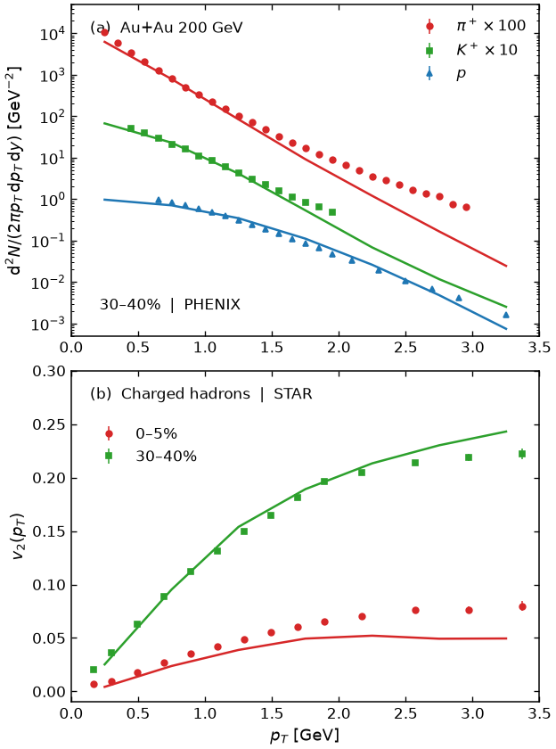
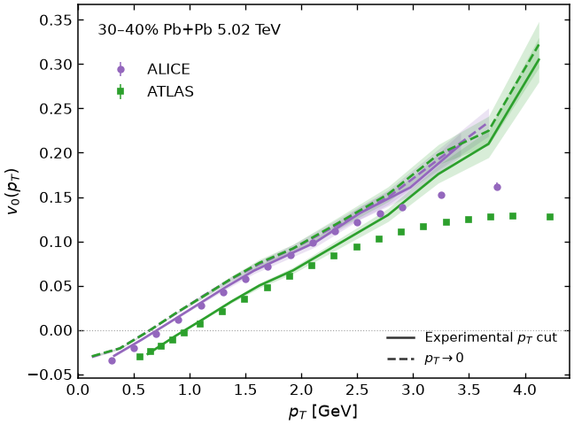
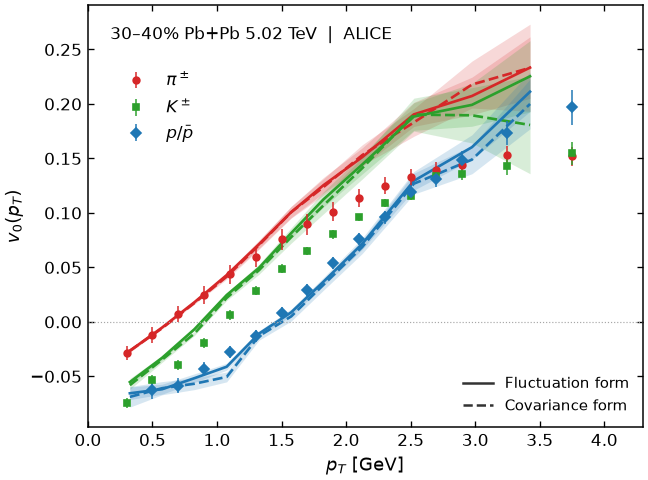

# Radial flow and mean-$p_T$ fluctuations

Default JETSCAPE configurations and plotting examples accompanying two studies by Lipei Du:

- [Characterizing radial flow fluctuations in relativistic heavy-ion collisions at top RHIC and LHC energies](https://arxiv.org/abs/2508.07184), *Physical Review C* **113**, 014901 (2026).
- [Kinematic and dynamical origins of mean-$p_T$ fluctuations in heavy-ion collisions](https://arxiv.org/abs/2512.22715), *Physics Letters B* **874**, 140225 (2026).

The model combines TRENTo initial conditions, pre-equilibrium free streaming, viscous hydrodynamics with MUSIC, Cooper–Frye particlization with iSS, and hadronic transport with SMASH. The default setup uses the Bayesian-calibrated maximum a posteriori (MAP) parameters, temperature-dependent shear and bulk viscosity, Grad-type viscous corrections and a switching temperature of 136 MeV. The configuration files provide a starting point for further studies; the notebook replots Figures 1–3 of the radial-flow paper from saved numerical results.

## Plot the published results

Install Python 3.10 or later and the dependencies, then open the notebook from this directory:

```bash
python -m pip install -r requirements.txt
jupyter lab Figures_1_to_3.ipynb
```

Run all cells in [Figures_1_to_3.ipynb](Figures_1_to_3.ipynb). All numerical inputs are bundled; no download, simulation or particle-level analysis is needed. The notebook generates the three figures from numbers and saves PNGs in `figures/`. To make the same plots without Jupyter:

```bash
python radial_flow.py
```

The functions in [radial_flow.py](radial_flow.py) can also be imported:

```python
from radial_flow import load_inputs, plot_figure2, read_zenodo

inputs = load_inputs()
fig = plot_figure2(inputs)
fig.savefig("charged_v0.svg")
# Read another .dat file downloaded from the same Zenodo deposit:
# result = read_zenodo("observables_..._centrality_results.dat")
```

### Figure 1: spectra and elliptic flow



Au+Au at 200 GeV: identified-hadron invariant spectra in 30–40% centrality and charged-hadron $v_2(p_T)$ in 0–5% and 30–40%. Markers show PHENIX spectra and STAR flow measurements; lines show the default model. The spectrum display factors are 100 for $\pi^+$, 10 for $K^+$ and 1 for protons. Model uncertainties are not supplied for these curves.

### Figure 2: charged-hadron radial-flow fluctuations



Pb+Pb at 5.02 TeV, 30–40%. Solid model curves use the ALICE-like or ATLAS-like momentum selection, with lower cuts of 0.2 and 0.5 GeV, respectively; dashed curves include particles down to $p_T=0$. Bands show the saved model statistical errors. ALICE and ATLAS markers use the official HEPData tables. Their error bars combine statistical and systematic uncertainties in quadrature; the separate components are retained in the experimental table.

### Figure 3: identified-hadron radial-flow fluctuations



The same Pb+Pb centrality, comparing $\pi^\pm$, $K^\pm$ and $p/\bar p$. Solid and dashed model curves show the saved fluctuation and covariance forms, respectively; bands are statistical errors. ALICE markers and experimental errors use the official HEPData tables. See Sec. III A and Appendix A of the radial-flow paper for the subevent analysis definitions.

## Default simulation setup

The [configs](configs/) directory contains one default physical parameter set for Au+Au at 200 GeV and Pb+Pb at 2.76 and 5.02 TeV. All three XMLs select 30–40% centrality. Change `centrality-low` and `centrality-high` for other classes, such as 0–5%. The supplied XMLs make the relevant framework fallback settings explicit.

The papers describe JETSCAPE v3.7. The version reference for these XMLs and supporting inputs is **v3.7.1**, with the following component revisions:

| Component | Version / revision |
| --- | --- |
| JETSCAPE, including TRENTo | [v3.7.1, `3546d35`](https://github.com/JETSCAPE/JETSCAPE/tree/3546d357141f54056af87f6f535467ed26a1289a) |
| MUSIC | [`1324482`](https://github.com/MUSIC-fluid/MUSIC/tree/132448235467999067f1c01f340736139499ce16) |
| iSS | [`db176d4`](https://github.com/chunshen1987/iSS/tree/db176d4cfaf804c9963f6927577d540f5f8be530) |
| Free-streaming | [`e0a21fe`](https://github.com/chunshen1987/freestream-milne/tree/e0a21feb48a922b4b4541ab0e4d745c65594bb5f) |
| SMASH | [3.0, `7eae4eb`](https://github.com/smash-transport/smash/tree/7eae4eb47f266f3234887aaec992c1715f494862) |

Build that version with the free-streaming, MUSIC, iSS and SMASH modules enabled, following the [JETSCAPE instructions](https://github.com/JETSCAPE/JETSCAPE/blob/3546d357141f54056af87f6f535467ed26a1289a/README.md). Keep its EOS, iSS tables and SMASH particle/decay tables in their standard locations. Copy the four supplied auxiliary files (`freestream_input`, `music_input`, `iSS_parameters.dat`, `smash_config.yaml`) into the build working directory, alongside the existing tables. From that directory, run:

```bash
./runJetscape /path/to/radial-flow-resources/configs/PbPb_5020_30_40.xml
```

Use a fresh working directory for each run. The XMLs request 1,000 framework iterations, five reuses per hydro background, and 20 sampler repetitions per iteration. These are run controls, not the total event statistics of the papers. Change the event count and random seed for the desired ensemble; seed 0 uses the framework's automatic seeding. Simulation output is stochastic. The notebook reproduces saved comparisons; the XMLs specify the simulation setup and do not themselves perform the observable analysis.

## Data and conventions

The two bundled `observables_*_5020_bulk_30_40_centrality_results.dat` files are unchanged copies from [Zenodo 17808246](https://zenodo.org/records/17808246). Their internal `ALICE` and `ATLAS` labels distinguish analysis selections applied to the model. `read_zenodo()` handles their sectioned Python/NumPy-style data notation without executing the file contents. It preserves unavailable values such as `nan` in unused sections.

| File / source | Contents |
| --- | --- |
| [Figure 1 model table](data/model/figure1_model.csv) | Saved model spectrum and $v_2$ curve values for the validation panels. |
| [No-low-cut model table](data/model/figure2_nocut.csv) | The additional charged-hadron curves and statistical errors used in Figure 2. |
| [Experimental table](data/experiment.csv): `phenix_spectra` | Positive-particle spectrum values and statistical errors from [PHENIX, PRC 69, 034909](https://arxiv.org/abs/nucl-ex/0307022), as used in Figure 1. |
| Experimental table: `star_v2` | STAR charged-hadron flow points and supplied point errors from [PRC 72, 014904](https://arxiv.org/abs/nucl-ex/0409033), as used in Figure 1. |
| Experimental table: `alice_v0` | Official ALICE HEPData v1 tables for 30–40%: `fig11.yaml` (charged), `fig21pi.yaml` (pions), `fig21ka.yaml` (kaons), `fig21pr.yaml` (protons), Tables 2/10/11/12 of HEPData 10.17182/hepdata.166689.v1, from [record ins2908602](https://www.hepdata.net/record/ins2908602). Statistical and systematic errors are retained separately. |
| Experimental table: `atlas_v0` | Official ATLAS HEPData v1 table [10.17182/hepdata.158359.v1/t80](https://www.hepdata.net/record/ins2907010): `figure_aux_3_cent5.yaml`, first dependent variable, with reference momentum range 0.5–2 GeV. Statistical and systematic errors are retained separately. |

The replots retain the published model curves and use official HEPData measurements for the $v_0(p_T)$ comparisons. These replace the manually digitized ALICE points in the original comparisons.

In the CSV files, `pt_GeV` is the stored point or model-bin center; for ALICE HEPData it is the midpoint of the reported bin. `pt_low_GeV` and `pt_high_GeV`, where present, are the supplied horizontal bounds. ATLAS supplies point coordinates in this YAML table without bin edges; those bounds are left blank. `value` is the unscaled observable: invariant yield in GeV$^{-2}$ for `spectra`, dimensionless for `v2` and `v0`. `error_low` and `error_high` are nonnegative absolute magnitudes in the same units. Blank errors mean unavailable. For the HEPData rows, `stat_error_low/high` and `sys_error_low/high` preserve the source components. The displayed `error_low/high` is their quadrature sum, computed separately on each side, without assuming a bin-to-bin covariance. `source_table` identifies the table and `pt_coordinate` identifies a reported value or bin midpoint. `uncertainty` and `extraction` describe the error representation and point origin; the Figure 1 STAR errors remain `as_supplied`. Model bin edges and full covariance matrices are not supplied. The plotting functions perform no fit or event-level observable calculation.

## References

1. L. Du, “Characterizing radial flow fluctuations in relativistic heavy-ion collisions at top RHIC and LHC energies,” *Phys. Rev. C* **113**, 014901 (2026). [arXiv:2508.07184](https://arxiv.org/abs/2508.07184); [DOI:10.1103/9pvq-ph1c](https://doi.org/10.1103/9pvq-ph1c).
2. L. Du, “Kinematic and dynamical origins of mean-$p_T$ fluctuations in heavy-ion collisions,” *Phys. Lett. B* **874**, 140225 (2026). [arXiv:2512.22715](https://arxiv.org/abs/2512.22715); [DOI:10.1016/j.physletb.2026.140225](https://doi.org/10.1016/j.physletb.2026.140225).
3. J. H. Putschke *et al.* (JETSCAPE), “The JETSCAPE framework” (2019). [arXiv:1903.07706](https://arxiv.org/abs/1903.07706); [arXiv DOI:10.48550/arXiv.1903.07706](https://doi.org/10.48550/arXiv.1903.07706).
4. D. Everett *et al.* (JETSCAPE), “Phenomenological constraints on the transport properties of QCD matter with data-driven model averaging,” *Phys. Rev. Lett.* **126**, 242301 (2021). [arXiv:2010.03928](https://arxiv.org/abs/2010.03928); [DOI:10.1103/PhysRevLett.126.242301](https://doi.org/10.1103/PhysRevLett.126.242301).
5. D. Everett *et al.* (JETSCAPE), “Multisystem Bayesian constraints on the transport coefficients of QCD matter,” *Phys. Rev. C* **103**, 054904 (2021). [arXiv:2011.01430](https://arxiv.org/abs/2011.01430); [DOI:10.1103/PhysRevC.103.054904](https://doi.org/10.1103/PhysRevC.103.054904).
6. D. Everett *et al.* (JETSCAPE), “Role of bulk viscosity in deuteron production in ultrarelativistic nuclear collisions,” *Phys. Rev. C* **106**, 064901 (2022). [arXiv:2203.08286](https://arxiv.org/abs/2203.08286); [DOI:10.1103/PhysRevC.106.064901](https://doi.org/10.1103/PhysRevC.106.064901).
7. S. S. Adler *et al.* (PHENIX), “Identified charged particle spectra and yields in Au+Au collisions at $\sqrt{s_{\mathrm{NN}}}=200$ GeV,” *Phys. Rev. C* **69**, 034909 (2004). [arXiv:nucl-ex/0307022](https://arxiv.org/abs/nucl-ex/0307022); [DOI:10.1103/PhysRevC.69.034909](https://doi.org/10.1103/PhysRevC.69.034909).
8. J. Adams *et al.* (STAR), “Azimuthal anisotropy in Au+Au collisions at $\sqrt{s_{\mathrm{NN}}}=200$ GeV,” *Phys. Rev. C* **72**, 014904 (2005). [arXiv:nucl-ex/0409033](https://arxiv.org/abs/nucl-ex/0409033); [DOI:10.1103/PhysRevC.72.014904](https://doi.org/10.1103/PhysRevC.72.014904).
9. G. Aad *et al.* (ATLAS), “Evidence for the collective nature of radial flow in Pb+Pb collisions with the ATLAS detector,” *Phys. Rev. Lett.* **136**, 032301 (2026). [arXiv:2503.24125](https://arxiv.org/abs/2503.24125); [DOI:10.1103/ldcn-r2lq](https://doi.org/10.1103/ldcn-r2lq).
10. S. Acharya *et al.* (ALICE), “Long-range transverse-momentum correlations and radial flow in Pb-Pb collisions at the LHC,” *Phys. Rev. Lett.* **136**, 032302 (2026). [arXiv:2504.04796](https://arxiv.org/abs/2504.04796); [DOI:10.1103/l36g-6f46](https://doi.org/10.1103/l36g-6f46).

Model dataset: L. Du, “Characterizing radial flow fluctuations in relativistic heavy-ion collisions at top RHIC and LHC energies,” Zenodo, version 1 (2025), DOI:10.5281/zenodo.17808246. [Dataset and files](https://zenodo.org/records/17808246).

## Preparation

This collection was prepared with Codex assistance from the author's existing study configurations, numerical results and plotting notebooks. The notebook and helpers have been adapted for standalone use, with the $v_0(p_T)$ measurement tables taken from HEPData. The simulation components and experimental measurements remain attributable to their original authors.
